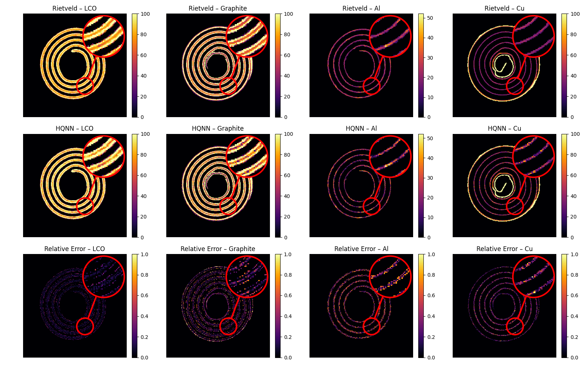
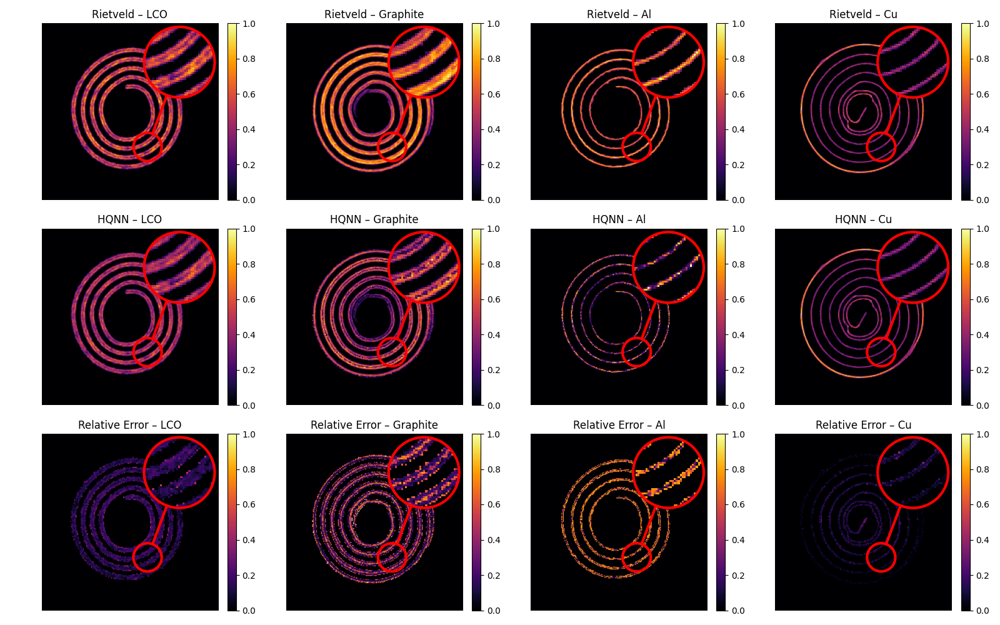

# Hybrid QNN for Quantitative Analysis of X-ray Diffraction Data

This repository contains the battery XRD-CT workflow used to train and deploy a hybrid quantum-classical neural network (HQNN). The model predicts phase weight fractions and scale factors from diffraction patterns.

## Pipeline

The workflow is divided into four stages:

1. **Pre-training**
   - Load single-phase diffraction libraries.
   - Generate synthetic mixtures by sampling phase scale coefficients.
   - Train a six-qubit QNN with separate weight-fraction and scale-factor MLP heads.

2. **IBM QPU execution**
   - Prepare simulated and experimental diffraction patterns.
   - Compile the QNN circuits locally.
   - Submit them through IBM Runtime Batch and download the measured QNN features.

3. **Head retraining**
   - Freeze the QNN.
   - Retrain the two MLP heads using QNN features measured on real hardware.

4. **Experimental inference**
   - Apply the retrained heads to experimental XRD-CT features.
   - Reconstruct weight-fraction and scale-factor maps.

## Installation

```powershell
conda env create -f environment.yml
conda activate hybrid-qnn-xrdct
```

## Usage

Generate the synthetic dataset and pre-train the model:

```powershell
python scripts/01_generate_battery_dataset.py --library PATH_TO_LIBRARY.h5
python scripts/01_pretrain_battery_dual_head.py --dataset data/battery_200k.h5
```

The reproducibility package also contains `data/battery_200k.h5` and
`data/sofc_200k.h5`. These Git LFS files contain the exact 200,000-mixture
corpora used by the code, including raw and 64-bin patterns, mixture
coefficients, physical weight fractions, physical and normalized effective
scale factors, source rows,
and deterministic train/validation/test assignments. Run `git lfs pull` after
cloning to download them. The SOFC file can be regenerated with:

```powershell
python scripts/01_generate_sofc_dataset.py --library PATH_TO_SOFC_LIBRARY.h5
```

Prepare data and execute the frozen QNN on IBM hardware:

```powershell
python scripts/02_prepare_qpu_inputs.py --kind simulated --input data/battery_200k.h5 --output data/qpu_simulated_20k.npz
python scripts/02_qpu_batch.py compile --inputs data/qpu_simulated_20k.npz --checkpoint outputs/pretraining/battery_dual_head.pt
python scripts/02_qpu_batch.py submit --inputs data/qpu_simulated_20k.npz --checkpoint outputs/pretraining/battery_dual_head.pt
python scripts/02_qpu_batch.py download --inputs data/qpu_simulated_20k.npz --checkpoint outputs/pretraining/battery_dual_head.pt
```

IBM credentials must be provided through `QISKIT_IBM_TOKEN` and `QISKIT_IBM_INSTANCE` environment variables.

Retrain the MLP heads and process experimental data:

```powershell
python scripts/03_retrain_hardware_heads.py --inputs data/qpu_simulated_20k.npz --features outputs/qpu_simulated/features --checkpoint outputs/pretraining/battery_dual_head.pt
python scripts/04_deploy_experimental.py --inputs data/qpu_experimental.npz --features outputs/qpu_experimental/features --checkpoint outputs/retrained_heads/hardware_retrained_dual_head.pt
```

The main settings are in [`configs/battery.yaml`](configs/battery.yaml).

## Results





